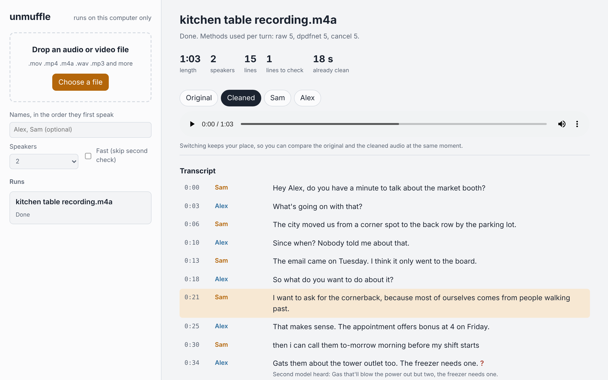
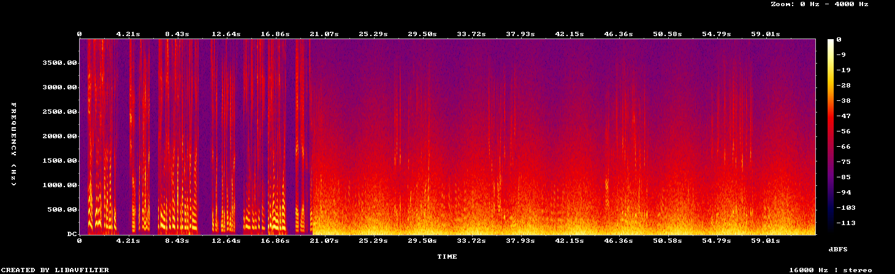
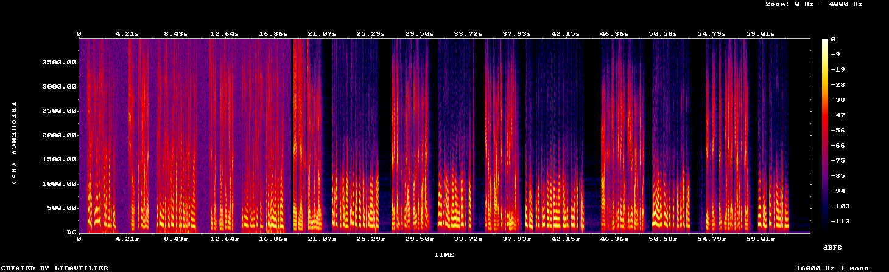

# unmuffle

[](https://github.com/auswallace/unmuffle/actions/workflows/ci.yml)

Get clear audio and a checked transcript out of a bad recording.

Drop in any audio or video file. For every speaker turn, unmuffle tries several ways of cleaning the audio, judges which one came out best, and keeps it. You get back a cleaned audio file, one file per speaker, and a transcript with speaker labels where every line is checked by a second model. Everything runs locally on CPU.

```
unmuffle serve                              # drag-and-drop page in your browser
unmuffle run meeting.mov --names "Alex,Sam" # or one file from the command line
unmuffle watch ~/Desktop/to-transcribe      # or a drop folder
```



**[Listen to the demo](https://auswallace.github.io/unmuffle/)**: a conversation where the phone goes into a pocket, before and after, with the transcript unmuffle produced.

```
meeting.unmuffle/
  cleaned.wav           the whole recording, cleaned, loudness-normalized
  speaker_alex.wav      only Alex's voice, same length as the original (silence elsewhere)
  speaker_sam.wav       only Sam's voice
  transcript.txt        timestamped, speaker-labeled; lines the two models disagree on end in [?]
  transcript.md         same, plus what the second model heard on those lines
  transcript.json       every line with time, method, speaker, confidence
  decisions.md          per turn: how each method scored, which one was used, and why
  report.json           clean and noisy parts, speakers found, voice matches, timings
```

## Where it started

A 7.5-minute meeting recorded on an iPhone. Two minutes in, the phone went into a pocket. From then on a steady rumble sat about 10 dB above the voices, below 1.6 kHz, right on top of speech. Whisper skipped a 37-second stretch entirely and made up filler elsewhere. Standard noise reduction and an AI voice isolator still left that stretch blank, even though a person could hear someone talking.

The fix came from the stereo channels. Phones record with two mics. The rumble reached both mics in almost the same way, and the voices did not. Cancelling what the two channels share removed the rumble and brought the missing voice back almost word for word. [`docs/case-study.html`](docs/case-study.html) walks through every attempt, including the ones that failed.

## Scorecard

Six synthetic recordings with known transcripts and known clean voices: the same two text-to-speech speakers (Sam and Alex) and the same script, with a different kind of noise each time. [`examples/scenarios.py`](examples/scenarios.py) builds them, and [`examples/scorecard.py`](examples/scorecard.py) runs plain Whisper and unmuffle on each and scores both.

| Noise | WER plain | WER unmuffle | Speakers right | Audio SI-SDR raw → cleaned | DNSMOS raw → cleaned | Judge picked best |
|---|---|---|---|---|---|---|
| pocket (phone pocketed at 0:20) | 0.48 | **0.20** | 93% | -9.4 → **-3.9 dB** | 1.77 → **3.01** | 100% |
| cafe (people talking around) | **0.31** | 0.50 | 93% | 2.4 → **3.0 dB** | 2.16 → **3.01** | 88% |
| wind | **0.06** | 0.07 | 100% | -0.7 → **9.7 dB** | 2.58 → **3.44** | 93% |
| hum + fan | **0.12** | 0.14 | 86% | 1.5 → **7.8 dB** | 1.72 → **3.20** | 100% |
| traffic | **0.06** | 0.09 | 100% | -1.3 → **6.1 dB** | 2.69 → **3.41** | 80% |
| music bed | **0.02** | 0.08 | 100% | 1.6 → **8.8 dB** | 1.83 → **3.36** | 100% |

How to read it:

- **WER** is word error rate (lower is better). Plain Whisper = Whisper turbo on the mono mix in 25 s windows.
- **SI-SDR** measures how close the audio is to the clean voices alone (higher is better). **DNSMOS** is a model's prediction of a listener rating from 1 to 5.
- **Judge picked best**: on noisy turns, how often the method unmuffle chose was the one closest to the clean voices. That is the test of whether the "try it, check it, keep the best" loop can be trusted on real files with no answer key.

What it shows:

- **Cleaned audio improves in every scenario**, by 3.6 to 11.1 dB SI-SDR and 0.7 to 1.5 DNSMOS points.
- **Speaker labels are right 86% to 100% of the time**, with no names given beyond the order people speak.
- **The transcript wins big only when the audio is really bad** (pocket: 0.48 → 0.20, and the muffled speaker's words found go from 12% to 81%). On milder noise, plain Whisper is already good and unmuffle is slightly worse. The main cause is context: unmuffle transcribes one speaker turn at a time, so Whisper sees a few seconds instead of 25. See the roadmap.
- **Cafe is the weak spot.** Voice isolation keeps every voice, including the people at the next table, so their words leak into the transcript.

The pocket scenario also ships as [`examples/demo.m4a`](examples/demo.m4a) with its outputs, so you can listen and read without running anything. Before (the original) and after (`cleaned.wav`) on that clip. After 0:20 the rumble fills everything below about 1 kHz; unmuffle removes it and both voices come back as clean harmonics:




## Real recordings

The scorecard above uses synthetic voices. [`examples/realbench.py`](examples/realbench.py) repeats the test on real speech mixed with real recorded noise from Microsoft's [MS-SNSD](https://github.com/microsoft/MS-SNSD) (MIT license): 4 real speech clips per file and one real noise recording at 0 dB SNR, where the noise is as loud as the speech. MS-SNSD has no transcripts, so the reference is Whisper turbo on the clean speech. The test files are mono, so the two-mic canceller is not used. Six of the nine noise types are done so far ([`examples/realbench.md`](examples/realbench.md)):

| Noise | WER plain | WER unmuffle | SI-SDR raw → cleaned | DNSMOS raw → cleaned |
|---|---|---|---|---|
| air conditioner | **0.02** | 0.08 | -0.7 → **7.6 dB** | 1.30 → **3.16** |
| airport announcements | **0.20** | 0.21 | -0.7 → **8.3 dB** | 1.20 → **3.11** |
| babble | **0.21** | 0.31 | -0.8 → **7.2 dB** | 1.44 → **2.97** |
| copy machine | 0.30 | **0.22** | -0.7 → **8.0 dB** | 1.14 → **3.02** |
| munching | 0.09 | **0.08** | -0.7 → **12.6 dB** | 2.44 → **3.27** |
| neighbor | **0.10** | 0.17 | -0.8 → **7.5 dB** | 2.03 → **3.11** |
| **mean** | **0.15** | 0.18 | -0.7 → **8.6 dB** | 1.59 → **3.11** |

The real recordings confirm the synthetic results:

- **The cleaned audio is much better on every noise type:** +9.3 dB SI-SDR and +1.5 DNSMOS on average.
- **On the transcript, Whisper is already robust to most steady noise.** unmuffle wins on copy machine and munching, ties on airport announcements, and loses on the others. It loses most on babble, the same background-voice problem as the cafe scenario.

## How it works

```
input file ── ffmpeg: decode to 16 kHz, keep both channels
  │
  ├─ build a track per method:  raw │ gtcrn (light isolation) │ dpdfnet (strong isolation) │ cancel (two-mic canceller + dpdfnet)
  │
  ├─ score the raw audio in 6 to 14 s chunks with DNSMOS → clean parts and noisy parts
  │
  ├─ speaker diarization, separately in the clean part and the noisy part
  │    (a muffled voice no longer sounds like itself, so voice prints only compare within a condition)
  │    tiny "speakers" (background voices) fold into real ones
  │    noisy-part voices are paired with clean-part voices for the best total match
  │
  ├─ for each speaker turn:
  │    clean → keep the original audio, transcribe it
  │    noisy → score every method with DNSMOS, transcribe the best two plus the canceller,
  │            judge = DNSMOS + words heard − loops, keep the winner
  │            the canceller only wins if it heard words voice isolation missed
  │            a second line is kept only if another method heard a different person
  │
  ├─ second model (Whisper medium.en) re-transcribes every line on the same audio; disagreement → [?]
  │
  └─ stitch the winners into cleaned.wav (crossfaded, level-matched), plus one file per speaker
```

### The judge

The judge decides which processing came out best without knowing the right answer:

- **DNSMOS** (Microsoft, from the DNS Challenge) predicts the listener ratings for voice quality (SIG), background (BAK), and overall (OVRL), from the audio alone.
- **Whisper's behavior.** Noise makes Whisper loop, say filler ("Thank you."), or return few words. A method that yields far fewer words than the best one, or loops, loses points.
- **Hysteresis.** If the method used for the same speaker's previous turn is within 0.15 points, it stays, so the cleaned audio does not flip between methods.

Every decision and its scores go into `decisions.md`.

### The canceller

For every frequency bin and every 2-second block, unmuffle learns the complex gain `a(f)` that best predicts the left channel from the right channel:

```
a(f) = Σ L(f,t)·conj(R(f,t)) / Σ |R(f,t)|²      over the block and its neighbors
out(f,t) = L(f,t) − a(f)·R(f,t)
```

The rumble carries most of the energy, so the prediction is mostly rumble, and subtracting it leaves the voice that differs between the mics. Plain `L − R` only works if the rumble is identical on both mics. The adaptive version handles the small level and phase differences at each frequency. On the original recording the channels correlated at 0.88. Plain subtraction cut the low-band rumble by about 12 dB. The adaptive canceller turned a gap Whisper could not read at all into full sentences.

### Speakers

Diarization (pyannote segmentation plus 3D-Speaker voice embeddings) is accurate within one condition, but a muffled voice no longer sounds like the same person clean. On the pocket demo, clean Sam and pocketed Sam scored only 0.34 cosine similarity, lower than pocketed Sam vs pocketed Alex. So unmuffle:

1. Diarizes the clean part and the noisy part separately. The clean part also gives the number of speakers, which the noisy part then uses.
2. Folds "speakers" with under 5 seconds (or under 8% of the speech) into the nearest real one. These are usually background voices.
3. Pairs each noisy-part voice with a different clean-part voice so the total similarity is highest (the Hungarian algorithm). This gets the pocket demo right even though no single comparison is clear.

A turn whose match margin is under 0.1 gets `[?]` after the speaker name.

### Noise hallucinations

On noise, Whisper says "so", "Thank you.", "[wind blowing]", or repeats a phrase over and over. unmuffle drops filler-only lines, strips sound annotations, and collapses repeated phrases. It also drops fragments of three words or fewer that the two models disagree on (they are listed in `report.json` under `dropped_fragments`).

### Clean and noisy parts

A chunk is clean when DNSMOS rates the raw audio at least 3.0 overall and 3.5 for background. Clean chunks keep the original audio: no processing beats it. `report.json` also notes the biggest lasting jump in the low-band (60 to 600 Hz) noise floor, which marks a covered mic: 20.2 s on the demo (true: 20.0 s) and 2:08.6 on the original recording.

## Install

Needs Python 3.10+ and ffmpeg (`brew install ffmpeg` on macOS).

```
git clone https://github.com/auswallace/unmuffle && cd unmuffle
pip install -e .
unmuffle models          # Whisper turbo + medium.en, DPDFNet, GTCRN, diarization, DNSMOS (about 2.5 GB)
```

Models come from the [sherpa-onnx GitHub releases](https://github.com/k2-fsa/sherpa-onnx/releases), so they download even on networks that block Hugging Face. They are cached in `~/.cache/unmuffle`. Set `UNMUFFLE_MODELS` to use another folder.

## Use

The page: run `unmuffle serve` and your browser opens `http://127.0.0.1:8765`. Drop a file, watch the stages, then switch between the original, cleaned, and per-speaker audio at the same moment and click any line to jump there. The server listens on this computer only and the page loads nothing from the internet. Runs are kept in `~/unmuffle-jobs` (change it with `--jobs`).

One file:

```
unmuffle run meeting.mov --names "Alex,Sam"
```

A drop folder. Leave it running and drop files in. A `<name>.unmuffle/` folder appears next to each file:

```
unmuffle watch ~/Desktop/to-transcribe
```

| Option | Default | What it does |
|---|---|---|
| `--names "A,B"` | Speaker 1, Speaker 2 | Names in the order the speakers first talk |
| `--speakers 3` | detect | Number of speakers, if you know it |
| `--methods raw,dpdfnet` | all four | Which cleaning methods to try (must include `raw`) |
| `--shortlist 3` | 2 | How many methods to transcribe per noisy turn. More is slower and sometimes better |
| `--check none` | `medium.en` | Skip the second-model check (saves about a third of the time) |
| `--model small.en` | `turbo` | Faster, less accurate main model |
| `--write-tracks` | off | Also write every method's full track, to compare by ear |

Runs resume. If a run stops, run the same command again and it continues from the cache.

**Speed.** On a 4-core ARM laptop VM, a 1-minute file takes about 3 to 4 minutes and a 7.5-minute file about 25 to 30. Most of it is Whisper: up to three methods per noisy turn, plus the check model. Peak memory stays under 4 GB because only one large model is loaded at a time.

## Test it on your own audio

- Record your own on a phone: a conversation in a car, in a kitchen with the fan on, and with the phone in a pocket. Real phone stereo is what the canceller was built for.
- [VoiceBank-DEMAND](https://datashare.ed.ac.uk/handle/10283/2791): noisy and clean versions of the same sentences, good for scoring.
- [Microsoft DNS Challenge](https://github.com/microsoft/DNS-Challenge): real noisy recordings and noise clips.
- [AMI Meeting Corpus](https://groups.inf.ed.ac.uk/ami/corpus/): real meetings with several mics and transcripts.
- [MUSAN](https://www.openslr.org/17/): music, speech, and noise clips to mix into clean speech.

To score a file you have a transcript for, write it in the `*_script.json` format (speaker, start, end, text per line) and run `python examples/score.py script.json file.unmuffle/transcript.json`.

## Limits

- The two-mic canceller needs a real stereo recording. A mono file still gets voice isolation and Whisper, without the canceller.
- It can't recover a voice the mics never picked up. It removes what the two mics share and doesn't add new information.
- Lines marked `[?]` need someone to listen to them.
- Automatic speaker counting can over-split real recordings: on the original 7.5-minute file it found 16 clusters in the clean part and folded them back to 2, mislabeling some lines. If you know the number of speakers, pass `--speakers N`.
- Voice isolation keeps every voice, including people in the background. In a busy cafe their words leak into the transcript.
- On mild noise, plain Whisper's transcript is slightly better (see the scorecard). The cleaned audio is still better.
- Music or several people talking at once needs source separation, which unmuffle does not do yet.

## Roadmap

- **Finish the real-recording benchmark** (shutting door, typing, vacuum cleaner) and add a second SNR.
- **Long-context transcription.** Transcribe the chosen audio in long windows with word timestamps, then split the words by speaker turn. This should remove most of the gap with plain Whisper on mild noise.
- **Background-voice filter.** Drop words whose voice print matches no known speaker (the cafe problem).
- **Source separation** for music and crosstalk, if a model can be fetched from GitHub.

## Tests

```
pip install -e ".[dev]" && pytest && ruff check .
```

CI runs the linter and the tests on Linux and macOS with Python 3.10 and 3.12.

The 26 tests use synthetic signals and need no models. They check that:

- the canceller removes at least 20 dB of correlated rumble, beats plain subtraction by at least 5 dB, and keeps a voice that differs between the mics
- the judge prefers more words over slightly better sound, penalizes loops, holds its previous choice when scores are close, and only keeps a second voice for different words
- the cleaned-audio stitch has no gaps at method switches
- pause cuts land in silence, and speaker turns clip and merge correctly
- the covered-mic point is found within one second, even next to loud speech
- chunked voice isolation handles every file length around a chunk boundary, and ffmpeg filters keep the sample rate

## Credits

[sherpa-onnx](https://github.com/k2-fsa/sherpa-onnx) (ONNX runtimes for Whisper, DPDFNet, GTCRN, pyannote segmentation, and 3D-Speaker embeddings), [DNSMOS](https://github.com/microsoft/DNS-Challenge) (Microsoft), OpenAI Whisper, pyannote, and ffmpeg.

The case study page was checked against the Floor rules of [Hallmark](https://github.com/Nutlope/hallmark) (MIT) with its `sloplint` linter.

MIT license.
